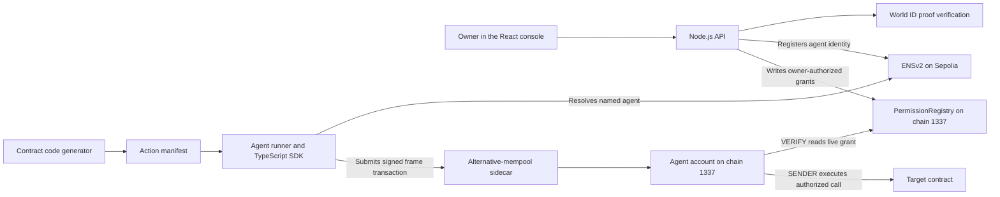

# Axon
**Ethereum accounts that let AI agents transact within permissions their owners control.**

Axon lets an owner authorize an agent to call specific functions across deployed smart contracts, set an ETH budget per spending period, set an expiry, and revoke access. The agent signs with its own key, and the account enforces the owner's rules onchain.

Axon makes Ethereum contracts easier for AI agents to discover and use. Contract manifests describe the available actions and their inputs, while ENSv2 gives each named agent a readable identity. The console uses World ID to verify human presence before submitting an agent registration or a change to its authority.

When an agent transacts, its account checks the live grant and enforces the spending budget. For private policies, the agent can prove that a specific call is authorized without revealing the rest of the policy.

## Why we built it

An agent that can decide what to do still needs a defined scope for what it can execute. An owner might allow an agent to deposit into a vault within a budget, then give it access to a second contract as its responsibilities grow. With Axon, the owner can update the grant without redeploying the agent account. Validation reads the live grant, so a change or revocation can take effect even after the agent has signed a transaction.

## How it works

1. **Define contract actions.** The code generator turns annotated Solidity, compiled ABIs, and deployment metadata into manifests. Each action identifies a deployed contract, a function, and its arguments. Developers can add actions for new contracts, and owners choose which actions each agent can execute.
2. **Register the agent and set its grant.** The console registers an ENSv2 subname on Sepolia and manages the agent's permissions on the EIP-8141 devnet (chain 1337). World ID provides a Proof of Human checkpoint before the console submits a registration or permission change.
3. **Sign and execute.** The TypeScript SDK encodes the call and builds a signed EIP-8141 transaction. The `VERIFY` frame checks the signature and live grant. The `SENDER` frame enforces the spending budget and executes the call.

For example, an owner can allow an agent to call `FinalCounter.increment()` while leaving ETH payments outside its grant. The same agent can call additional functions once the owner updates the allowlist. The contract manifest tells the SDK how to build each call, and the onchain grant determines whether the agent can execute it.

## Basic architecture



Sepolia supplies the agent's identity and signer binding. The EIP-8141 devnet holds the grant and executes the transaction. For private calls, the runner includes a zero-knowledge proof in the intent, and the scoped account checks it in `SENDER` before calling the target.

## Integrations and devnet plumbing

- **ENSv2** gives agents human-readable identities on Sepolia. The parent name's UserRegistry organizes agents as subnames for role-based delegation, and its Permissioned Resolver stores identity records. The devnet's `PermissionRegistry` enforces each agent's grant.
- **World ID** supplies a Proof of Human checkpoint. The React console requests proof through IDKit, and the Node.js backend verifies it before submitting an agent registration or an owner-authorized permission change.
- **Alternative mempool** admits EIP-8141 frame transactions on the execution devnet. Reading a separate permission registry during validation triggers a canonical mempool restriction, so the SDK submits through the sidecar. The devnet lacked standard transaction indexing, so the SDK also tracks inclusion through the sidecar. This split lets Axon resolve names on Sepolia and execute frame transactions on the devnet.

## Private permissions

An optional `ScopedAgentAccount` lets an agent prove that a specific call is authorized while keeping unused rules and their spending ceilings private. The owner publishes a salted Poseidon Merkle root and shares the relevant rule and witness with the agent. The agent uses a Circom circuit to generate a Groth16 proof bound to the current root, call scope, intent nonce, and ETH value. The account verifies the proof before executing the call. The executed call and public spending budget remain visible. The [private demo](why%20zk.md) supports FinalCounter increments and ETH payments.

## Repository modules

| Module | What it does |
| --- | --- |
| [`contracts/`](contracts) | Solidity agent accounts, the permission registry, and demo contracts. |
| [`sdk/`](sdk/README.md) | TypeScript client for ENS resolution, intent construction, frame signing, simulation, and sidecar submission. |
| [`codegen/`](codegen) | Generates action manifests from annotated Solidity, compiled ABIs, and deployment metadata. |
| [`agent/`](agent) | Agent runtime and command-line demo runners for selecting and executing actions. |
| [`final/frontend/`](final/frontend/README.md) | React console for managing agents and grants, running demo calls, and viewing activity. |
| [`final/server/`](final/server/README.md) | Node.js API for World ID verification, ENS registration and lookup, permission updates, and demo calls. |
| [`zk/`](zk) | Circom circuit and scripts for committing private rules and generating Groth16 proofs. |
| [`.agents/skills/axon-transactions/`](.agents/skills/axon-transactions/SKILL.md) | Codex skill for simulating or submitting FinalCounter calls with the agent runner. |

The Foundry contracts use [`forge-std`](contracts/lib/forge-std) as a Git submodule for Solidity tests and scripts.

## Run locally

With Node.js 24 and npm installed, run from the repository root:

```sh
./start.sh
```

This installs missing SDK, server, and frontend dependencies, then starts the API
and Vite with automatic reload. Open <http://localhost:5173> or
<http://localhost:5173/app>. The API runs on port 8900 and serves JSON only when launched with this script.
The frontend sends API requests directly to it. Press Ctrl+C to stop both services.

The server uses the existing `.env` configuration and `final/deployment.json`.
The configured devnet RPC and sidecar run remotely. Starting the app does not
redeploy contracts or execute agent transactions.

## ENS / World ID environment variables (`final/server/.env`)

```
# ENSv2 on Sepolia — agent identity & control plane
SEPOLIA_RPC=https://sepolia.infura.io/v3/YOUR_KEY
# Optional archive RPC for reading ENS hierarchy logs. Defaults to Sepolia PublicNode.
# SEPOLIA_INDEX_RPC=https://ethereum-sepolia-rpc.publicnode.com
SEPOLIA_OWNER_PRIVATE_KEY=0x...          # owner key for ENS text record updates
ENS_REGISTRY=0x...                        # optional legacy Axon name registry for older records
HUMAN_ENS_NAME=alice.eth                  # human parent name

# World ID Agent Pass — human approval gate for authority changes
WORLD_ID_APP_ID=your_app_id               # from https://auth.world.org/portal
WORLD_ID_RP_ID=rp_...
WORLD_ID_SIGNER_ADDRESS=0x...
WORLD_ID_RP_SIGNING_KEY=...               # private RP signing key, server only
WORLD_ID_VERIFIER_URL=https://developer.world.org/api/v4
```

## Console routes

- `/app` — human vs agent call console (optional ENS agent selector)
- `/app/agents` — ENS agent subdomain manager (create, resolve, revoke agents)
- `/app/permissions` — permission editor (default account or ENS-scoped agents)
- `/app/activity` — transaction history

## API endpoints

- `GET /api/state` — now includes `ens` (human name + resolved agents)
- `GET /api/ens/resolve?name=trader.alice.eth` — resolve an agent subdomain
- `GET /api/ens/agents?name=alice.eth` — read the onchain ENS hierarchy and its Axon agents
- `POST /api/ens/register` — create a new agent subdomain (World ID gated)
- `POST /api/call` — accepts optional `agentName` to call as that ENS agent
- `POST /api/permission` — accepts `agentName` + `worldIdProof` for ENS-scoped updates

To choose different local ports:

```sh
FINAL_PORT=8902 FRONTEND_PORT=5175 ./start.sh
```


